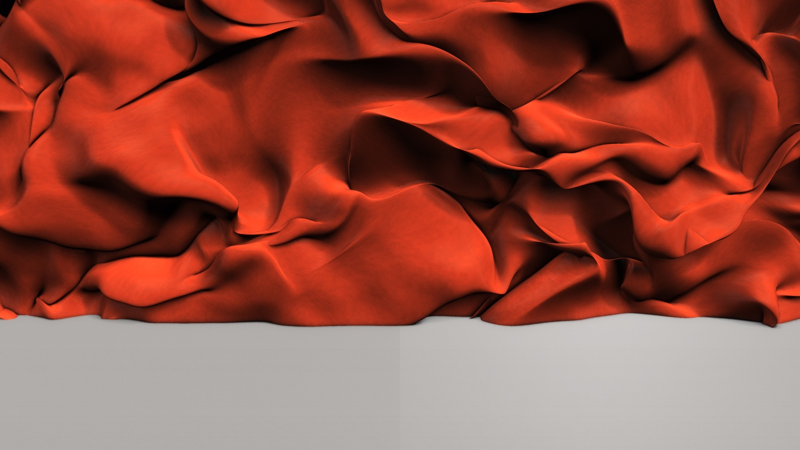
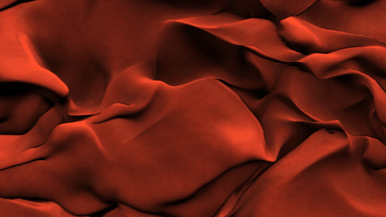
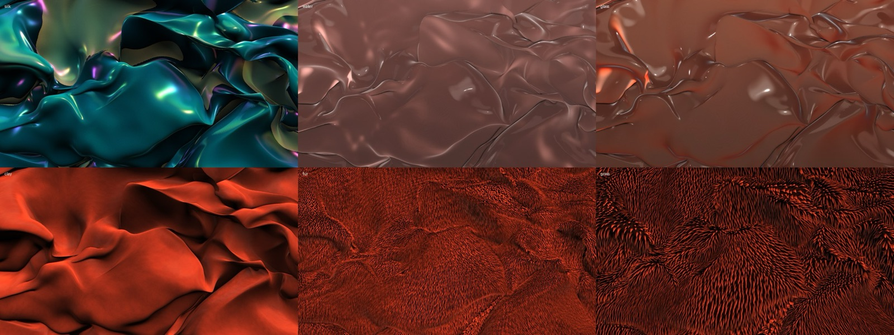
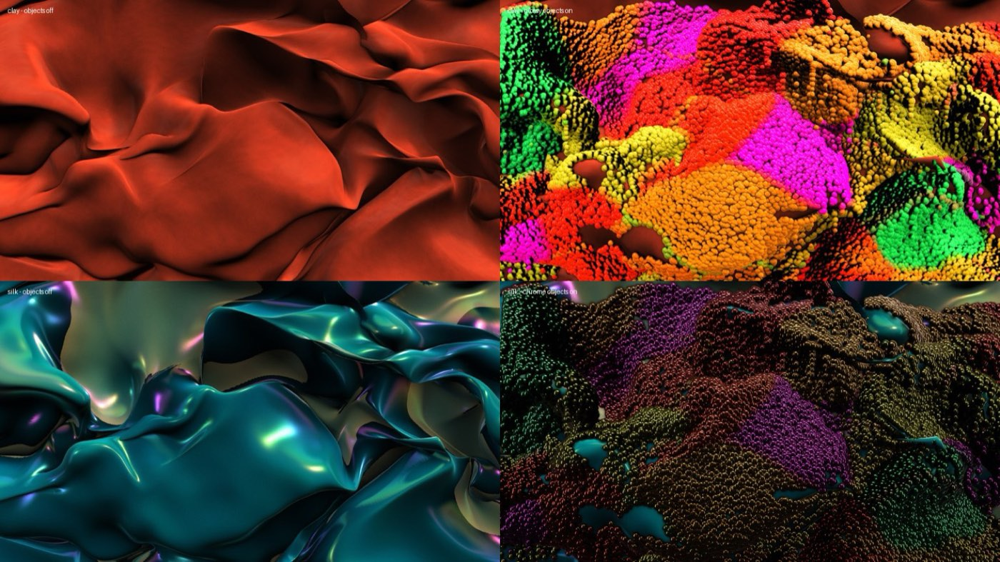
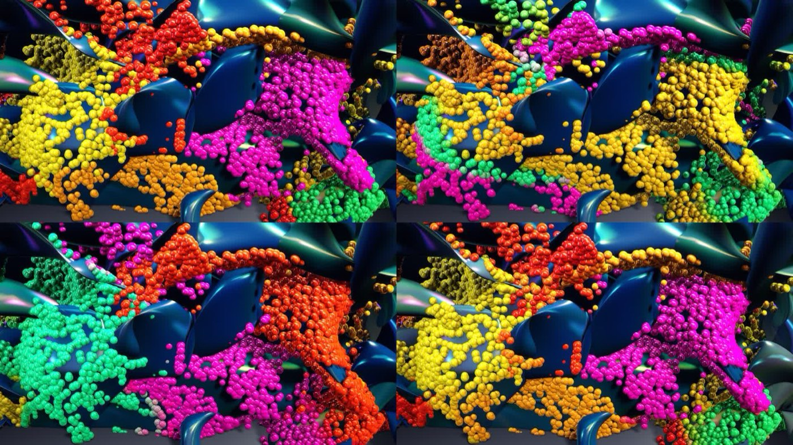
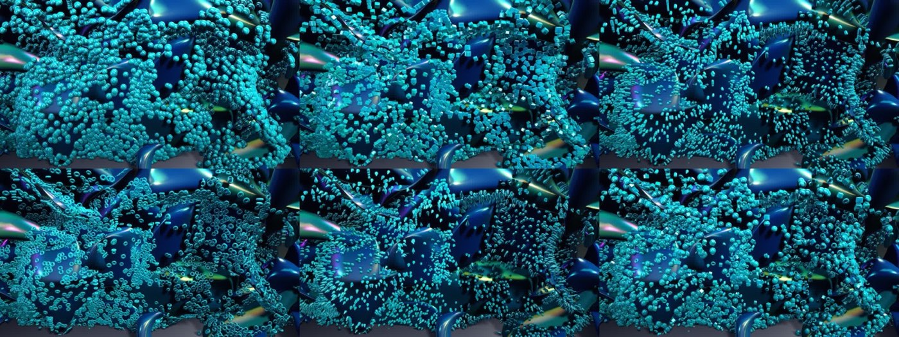
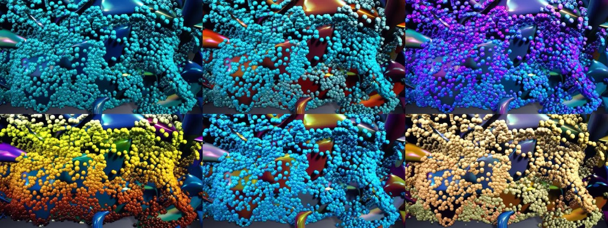
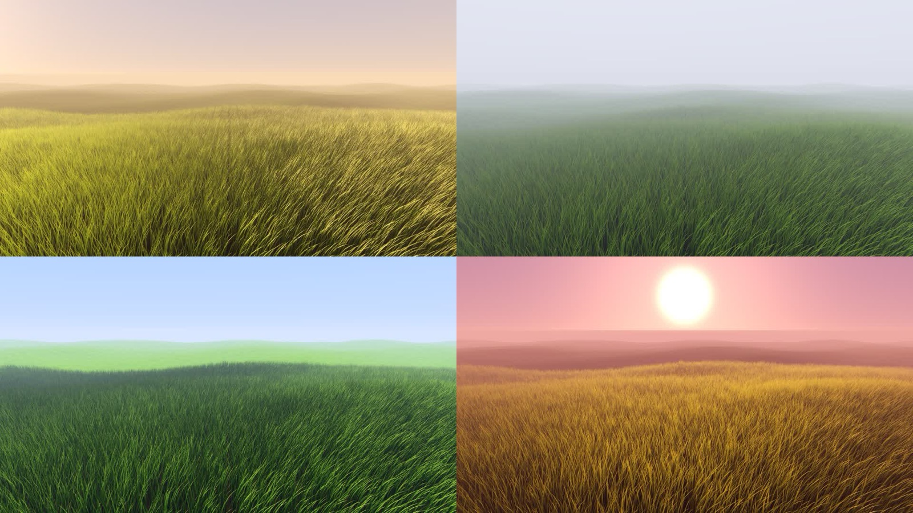
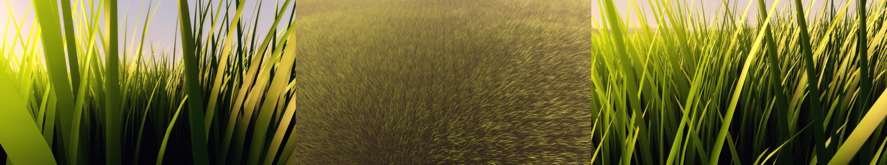
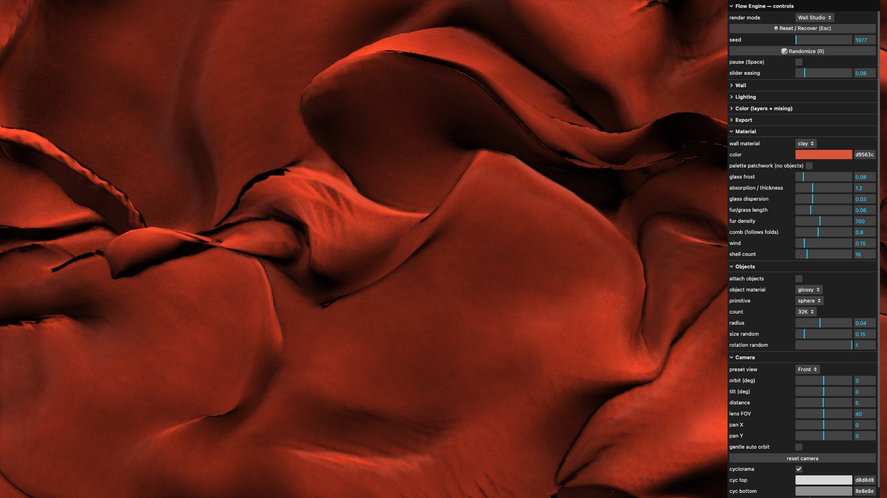

# Flow Engine

A real-time **WebGL2 generative fabric / wall renderer** for studio-style motion art. A folding, undulating fabric wall is lit like a 3D studio render, can be switched between materials, covered with thousands of pinned primitives, colored with patchwork palettes, and exported as print-size tiled stills or 1080p60 video. Everything runs locally in the browser (Vite + TypeScript, no framework).





## Features

- **Wall Studio mode (default):** a single front-facing wavy fabric wall with fold, warp and flow controls.
- **Materials:** silk (glossy and iridescent), water, glass, clay, fur and grass. Each takes a solid color, or a palette patchwork when no objects are attached.
- **Attached objects:** up to 131K pinned primitives (sphere, rounded cube, capsule, torus, teardrop or mixed), ray-marched impostors that cast and receive shadows. Object materials are glossy, chrome, glass and clay. Size and rotation can be randomized.
- **Color system:** editable palettes with randomize and save, per-layer palettes, blend modes, mix and opacity, hue shift and cycling, gradient direction, contrast and saturation. **Patchwork** mode paints large color regions (Voronoi, noise blobs or bands) with controls for scale, softness, seed, jitter and drift.
- **Lighting:** PBR (GGX) shading, PCSS soft shadow maps, SSAO contact shadows, bloom, and ACES / filmic (AgX-style) / exponential tone mapping. There is a gradient cyclorama backdrop and film grain.
- **Lighting presets:** C4D Studio Softbox, Rim Dramatic, High-key White, Colored Gels, Studio 3-point, Softbox top, Rim/backlit and more. Custom lights are supported.
- **Camera:** Front, 3/4 left, 3/4 right, Close-up and Wide presets. Mouse orbit, pan and zoom, sliders, reset, and clamping that keeps the wall edges out of frame.
- **Other modes:** Grass Field (instanced wind-blown blades with sun/sky lighting and camera presets), Liquid Spheres, Particle Fabric (GPU particles with gravity wells), classic 3D fabric and 2D curl-noise flow.
- **Deterministic:** the same seed and parameters give the same frame, so stills and video re-simulate from frame 0.
- **Export:** tiled stills at 4K, 8K, Topsheet 20400×3900 and Wrap 4500×19500 portrait (with PDF), plus custom sizes and a CMYK-safe toggle. 1080p60 MP4 video uses ffmpeg.

## Screenshots

| Materials (silk, water, glass / clay, fur, grass) | Objects off vs on |
|---|---|
|  |  |

| Patchwork palettes | Primitives |
|---|---|
|  |  |

| Color combos | Grass Field lighting presets |
|---|---|
|  |  |

| Grass Field camera presets | Control panel |
|---|---|
|  |  |

## Quick start

Requirements: Node 20+ and a WebGL2 browser (developed on Chrome on Apple Silicon). Exports also need `ffmpeg` on your PATH for video.

```bash
npm ci
npm run dev      # http://127.0.0.1:5190
npm run build    # static build in dist/ (live viewer only)
```

Still and video export use the dev server's helper middleware (`vite.config.js`). It stitches tiles with `sharp`, pipes frames to `ffmpeg` and writes to `out/`, so exports work under `npm run dev` and not under a static build.

## Controls

- **Panel (lil-gui):** only the folders for the current mode are shown. In Wall Studio these are Wall, Material, Objects, Lighting, Camera, Color and Export.
- **Mouse (Wall Studio / Grass Field):** drag to orbit, right-drag or shift-drag to pan, and scroll to zoom.
- **Keys:** `Space` pauses, `R` randomizes, and `Esc` resets and recovers.

## URL parameters

| Param | Example | Meaning |
|---|---|---|
| `mode` | `grass`, `spheres`, `particles`, `3d`, `2d` | Start in another mode (default is Wall Studio) |
| `wmat` | `silk` `water` `glass` `clay` `fur` `grass` | Wall material |
| `wobj` | `1` | Attach objects |
| `omat` | `glossy` `chrome` `glass` `clay` | Object material |
| `wview` | `Front`, `Wide`, `Close-up` | Wall camera preset |
| `wlight` | `Rim Dramatic` | Wall lighting preset (exact name) |
| `seed`, `palette`, `preset` | | Seed, palette and export preset |
| `auto` | `still` / `video` | Render a still or video automatically after load (`after=<frames>`, `secs=<n>`) |
| `debug` | `1` | Show the HUD |

Other params cover the legacy modes, for example `glight`, `gview`, `prim`, `combo` and `pshape`. See the end of `src/main.ts`.

## Export presets

| Preset | Size |
|---|---|
| 4K UHD | 3840×2160 |
| 8K | 7680×4320 |
| Topsheet 68×13 in @300 | 20400×3900 |
| Wrap City Blue 15×65 in @300 | 4500×19500 (portrait, PNG + PDF) |
| Custom | any |

Video is 1080p60 H.264 (CRF 26).

`scripts/headless-capture.mjs` takes screenshots in a separate headless Chrome profile, for example to batch auto-renders: `node scripts/headless-capture.mjs "http://127.0.0.1:5190/?auto=still&wmat=glass" 60 out/glass`. Set `CHROME=/path/to/chrome` if Chrome is somewhere else.

## Project structure

```
index.html
vite.config.js            dev server + tile-stitch / ffmpeg helper middleware
src/main.ts               params, GUI, simulation, render loop, export
src/shaders.ts            fabric, lighting (PBR/PCSS/SSAO), materials, spheres, color/patchwork, post
src/grass_shaders.ts      Grass Field blades, ground, sky
scripts/headless-capture.mjs
docs/images/              README screenshots
```

## Known limitations

- **Water and glass are not truly transmissive.** They refract and reflect a procedural studio backdrop rather than the scene behind them, so they read as glossy tinted surfaces.
- **Fur and wall grass are shell-rendered**, not individual strands. Wall grass does not use the Grass Field blade system.
- **Performance** (Apple Silicon, 1080p): silk, water, glass and clay hold 60 fps. Fur runs at about 30, wall grass at about 20, and attached objects (32K) at about 12–23.
- There is no depth-of-field pass yet, and shadow edges can show some aliasing in the live preview.
- Exports require the dev server. Video export is 1080p60 only.
- `main.ts` is one large file. It's a prototype that grew fast.

## License

MIT © 2026 John Hanusek
