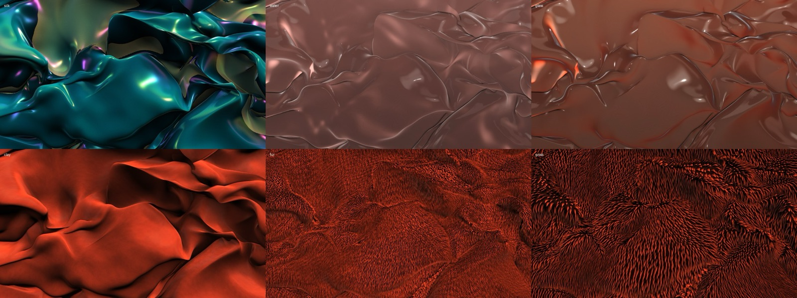
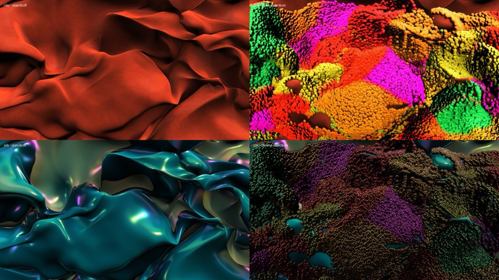
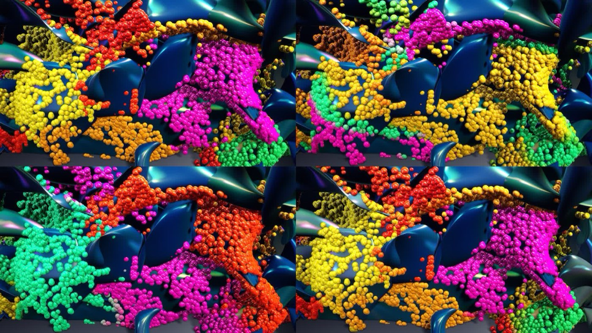
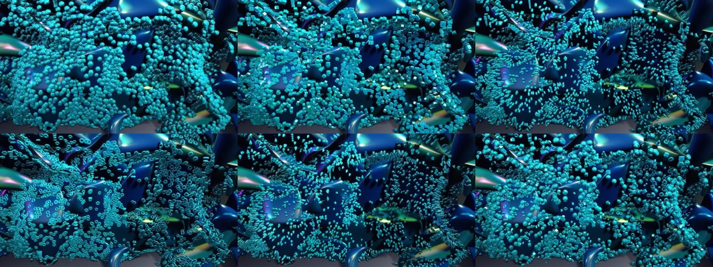
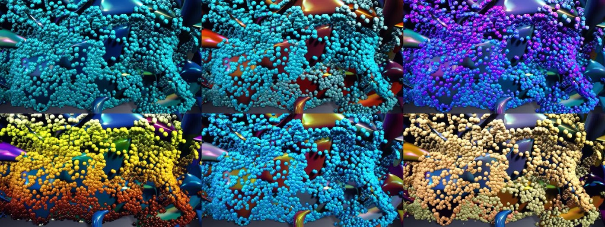
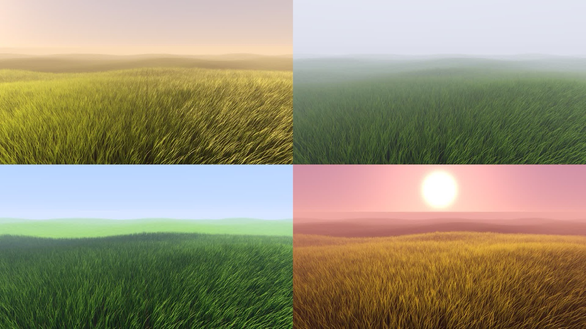
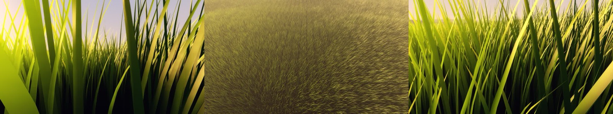
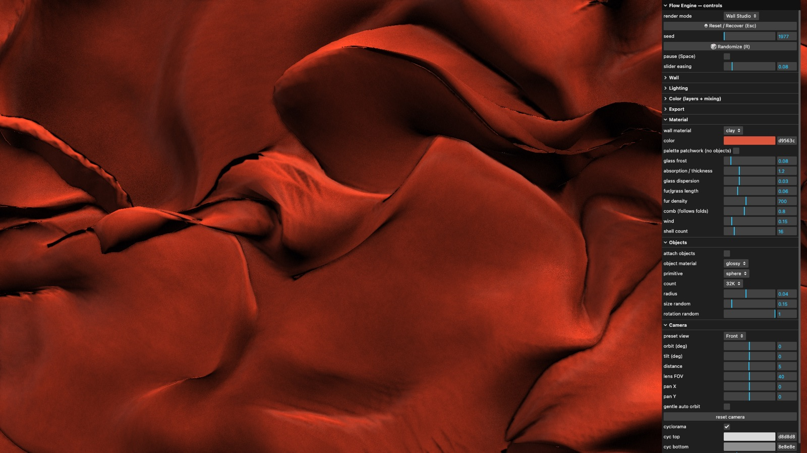

# Flow Engine

A real-time **WebGL2** engine for Cinema-4D-style studio motion art. The visible lineup is a set of physical scenes (paint, city, jungle, stargate, fabric) plus a 3D fractal, all with live per-mode controls and presets. Everything runs locally in the browser (Vite + TypeScript, no framework).

## Features

- **Lineup (default = Jungle):** Paint (Splash, plus Paint Pour), City Vortex, Jungle (tropical motifs and a forest-floor tunnel wall), Stargate, Fabric (Drift ribbons), 3D Fractal, Bead Knot, Mirror Mandala, Feather Vortex and Crystal Temple. Each mode has its own sliders, knobs, selectors and 3–6 presets.
- **Paint:** live screen-space splashes thrown at the camera (default), plus the classic pour / drip-wall canvases and a separate Paint Pour loop (Cycles viscous-liquid bake).
- **City Vortex:** a flight through neighbourhoods of glass downtown, brownstones, industrial blocks and a waterfront, with traffic and window lights.
- **Jungle:** a vortex of flowers and leaves that journeys through orchids, heliconia, monstera, ferns, bromeliads and a lotus garden, over a mossy dirt/grass floor.
- **Stargate:** a 2001-style slit-scan light corridor, with density, warp, glow and lens controls.
- **Fabric:** several woven silk ribbons drifting toward the camera, with complementary palettes and anisotropic sheen.
- **3D Fractal:** Mandelbulb, Mandelbox and related forms in a C4D studio cove, with the same per-mode preset panel as the others.
- **Bead Knot:** glossy torus-knot bead ribbons wrapping a glowing crystal core, with a slow orbit and morph.
- **Mirror Mandala:** a bilateral (or radial) 3D tendril mask of beaded lines and bubble lobes, with a slight RGB fringe, breathing grow and inward zoom.
- **Feather Vortex:** a swirling kaleidoscope of 3D feather blades around a dark core, with anisotropic sheen and a feedback trail.
- **Crystal Temple:** a kaleidoscopic tunnel of stacked prism ridges and flanking tendrils, with anisotropic metal, a traveling cyan pulse and a starfield void.
- **Studio look:** pastel palettes, soft AO, gloss, Khronos Neutral / ACES tonemap, bloom and a gentle grade. Audio reactivity is off by default.
- **Deterministic:** the same seed and parameters give the same frame, so stills and video re-simulate from frame 0.
- **Export:** tiled stills at 4K, 8K, Topsheet 20400×3900 and Wrap 4500×19500 portrait (with PDF), plus custom sizes and a CMYK-safe toggle. 1080p60 MP4 video uses ffmpeg.

Older visualizers (Wall Studio, Landscape, Morph, Plasma, MilkDrop, 3D fabric, Liquid Spheres, Particle Fabric, 2D flow, Tunnel, Kaleido) and the paused Gravity scene keep their code. They are hidden from the menus, the preset gallery and the remote UI. Old URLs and presets that name them fall back to Jungle.

## Screenshots

| Materials (silk, water, glass / clay, fur, grass) | Objects off vs on |
|---|---|
|  |  |

| Patchwork palettes | Primitives |
|---|---|
|  |  |

| Color combos | Grass Field lighting presets |
|---|---|
|  |  |

| Grass Field camera presets | Control panel |
|---|---|
|  |  |

## Quick start

Requirements: Node 20+ and a WebGL2 browser (developed on Chrome on Apple Silicon). Exports also need `ffmpeg` on your PATH for video.

```bash
npm ci
npm run dev      # http://127.0.0.1:5190
npm run build    # static build in dist/ (live viewer only)
```

Still and video export use the dev server's helper middleware (`vite.config.js`). It stitches tiles with `sharp`, pipes frames to `ffmpeg` and writes to `out/`, so exports work under `npm run dev` and not under a static build.

## Controls

- **Panel:** the mode's own sliders, knobs, selectors and presets, plus shared Color, Lighting, Audio and Export sections. Press `G` for the legacy lil-gui.
- **Keys:** `Space` pauses, `R` randomizes, and `Esc` resets and recovers.

## URL parameters

| Param | Example | Meaning |
|---|---|---|
| `mode` | `Jungle`, `Paint`, `Paint Pour`, `City Vortex`, `Stargate`, `Fabric`, `3D Fractal`, `Bead Knot`, `Mirror Mandala`, `Feather Vortex`, `Crystal Temple` (aliases: `city`, `fractal`, `paint-pour`, `bead`, `mandala`, `feather`, `crystal`, `temple`) | Start in a lineup mode (default is Jungle). Retired names such as `landscape`, `wall`, `3d`, `2d`, `gravity` fall back to Jungle. |
| `wmat` | `silk` `water` `glass` `clay` `fur` `grass` | Wall material |
| `wobj` | `1` | Attach objects |
| `omat` | `glossy` `chrome` `glass` `clay` | Object material |
| `wview` | `Front`, `Wide`, `Close-up` | Wall camera preset |
| `wlight` | `Rim Dramatic` | Wall lighting preset (exact name) |
| `seed`, `palette`, `preset` | | Seed, palette and export preset |
| `auto` | `still` / `video` | Render a still or video automatically after load (`after=<frames>`, `secs=<n>`) |
| `debug` | `1` | Show the HUD |

Other params cover the legacy modes, for example `glight`, `gview`, `prim`, `combo` and `pshape`. See the end of `src/main.ts`.

## Export presets

| Preset | Size |
|---|---|
| 4K UHD | 3840×2160 |
| 8K | 7680×4320 |
| Topsheet 68×13 in @300 | 20400×3900 |
| Wrap City Blue 15×65 in @300 | 4500×19500 (portrait, PNG + PDF) |
| Custom | any |

Video is 1080p60 H.264 (CRF 26).

`scripts/headless-capture.mjs` takes screenshots in a separate headless Chrome profile, for example to batch auto-renders: `node scripts/headless-capture.mjs "http://127.0.0.1:5190/?auto=still&wmat=glass" 60 out/glass`. Set `CHROME=/path/to/chrome` if Chrome is somewhere else.

## Project structure

```
index.html
vite.config.js            dev server + tile-stitch / ffmpeg helper middleware
src/main.ts               params, GUI, simulation, render loop, export
src/shaders.ts            fabric, lighting (PBR/PCSS/SSAO), materials, spheres, color/patchwork, post
src/grass_shaders.ts      Grass Field blades, ground, sky
scripts/headless-capture.mjs
docs/images/              README screenshots
```

## Known limitations

- **Water and glass are not truly transmissive.** They refract and reflect a procedural studio backdrop rather than the scene behind them, so they read as glossy tinted surfaces.
- **Fur and wall grass are shell-rendered**, not individual strands. Wall grass does not use the Grass Field blade system.
- **Performance** (Apple Silicon, 1080p): silk, water, glass and clay hold 60 fps. Fur runs at about 30, wall grass at about 20, and attached objects (32K) at about 12–23.
- There is no depth-of-field pass yet, and shadow edges can show some aliasing in the live preview.
- Exports require the dev server. Video export is 1080p60 only.
- `main.ts` is one large file. It's a prototype that grew fast.

## License

MIT © 2026 John Hanusek
